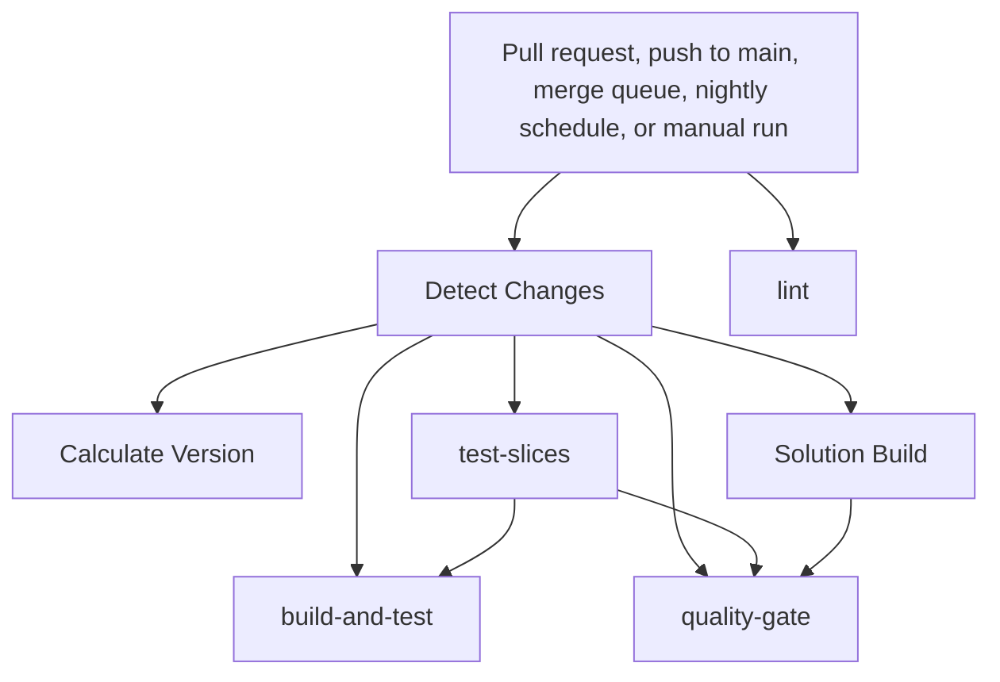
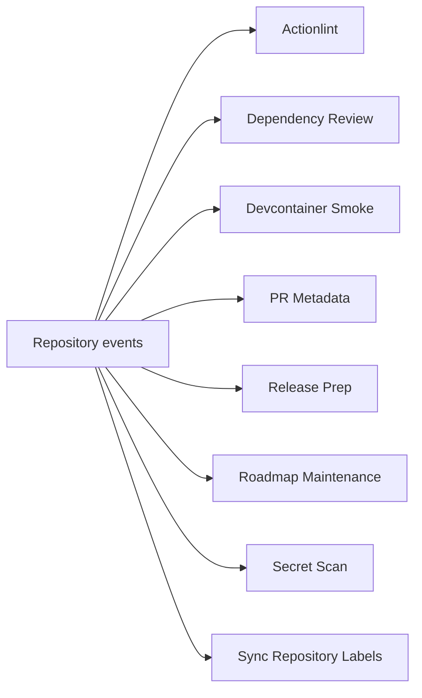
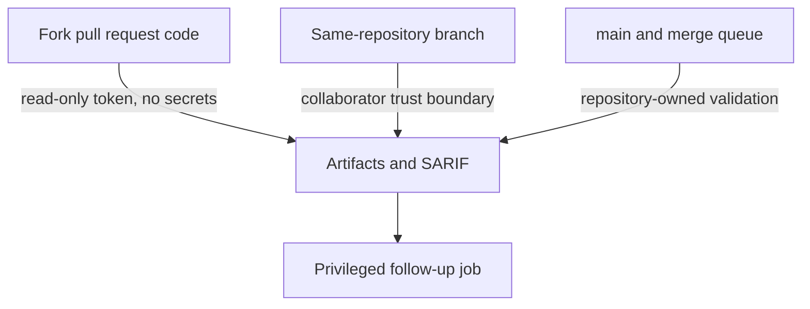

# CI and local validation flow

Generation ownership: source/configuration in [generated-diagrams.json](generated-diagrams.json),
with per-output sources in the [diagram inventory](generated-diagram-roadmap.md).
Refresh: `dotnet tool run sharedkernel-docs -- generate --config docs/architecture/generated-diagrams.json`;
check: the same command with `verify` instead of `generate`.
Edit manual narrative outside generated markers; review under the
[documentation governance policy](../DOCUMENTATION_GOVERNANCE.md#generated-output-review-and-finalization).

This page summarizes the current validation architecture and links the maintainable source docs. It
separates required merge gates from supplemental workflows and local reproduction paths.

## Current required merge-gate lanes

This diagram is generated from `.github/workflows/ci.yml` job names and `needs` edges.

<!-- generated:ci-main-jobs:start -->
<!-- Generated by sharedkernel-docs. Do not edit by hand. -->

<!-- generated:ci-main-jobs:end -->

Required checks and workflow-job mapping: [governance](../ci/governance.md#branch-protection-rules).
Workflow details: [CI overview](../ci/overview.md) and [main workflow](../ci/main-workflow.md).

## Fast lanes versus dependency-heavy lanes

| Lane | Current purpose | Cost posture |
| --- | --- | --- |
| `Calculate Version` | Run the versioning tool and expose release-version outputs. | Runs after change selection. |
| `Test slices` | Run the selected test projects of the fast, provider/database, full-host API, and browser/system rows. | Matrix rows run independently. |
| `Lint` | Markdown, scripts, specs, and repository quality checks. | Runs after change selection. |
| `Dependency Review` | Scan dependency manifest and lock-file diffs. | Fast governance lane. |
| `Secret Scan` | Detect committed secrets and publish SARIF when allowed. | Fast security lane. |
| `Quality Gate` | Enforce the changed-code coverage threshold over the slices' reports. | Runs after tests; no analysis secrets. |

`sharedkernel-ci select`, configured by `.config/sharedkernel-ci.json`, owns path decisions. If diff
or project-graph detection is uncertain, it selects every test project so CI runs more work rather than
skipping a needed check.

## Supplemental workflows

This diagram is generated from workflow file names and workflow `name` values.

<!-- generated:ci-supplemental-workflows:start -->
<!-- Generated by sharedkernel-docs. Do not edit by hand. -->

<!-- generated:ci-supplemental-workflows:end -->

Supplemental workflows are intentionally outside the normal required merge gate:

- `Actionlint` validates workflow edits and local composite actions.
- `Devcontainer Smoke` validates the containerized developer path on schedule, manual dispatch, and
  post-merge changes to `.devcontainer/**`, `global.json`, `setup-dev.sh`, or the workflow.
- `Sync labels` is repository-owned administrative automation and never runs on pull requests.

Source doc: [supplemental workflows](../ci/supplemental-workflows.md).

## Local reproduction commands

Use the narrowest command that reproduces the failing lane.

| Area | Command |
| --- | --- |
| Full build | `dotnet build ViajantesTurismo.slnx` |
| Full test suite | `dotnet test --solution ViajantesTurismo.slnx` |
| Repository content checks | `dotnet tool run sharedkernel-repo -- verify-links --root .` and the other `verify-*` checks of the Lint job |
| Generated documentation drift | `dotnet tool run sharedkernel-docs -- verify --config docs/architecture/generated-diagrams.json` |
| CI change classification | `dotnet tool run sharedkernel-ci -- select --base <commit>` |
| One CI test slice | `dotnet tool run sharedkernel-ci -- run --slice <name>` |
| Devcontainer smoke | `dotnet tool run sharedkernel-repo -- verify-devcontainer --exec "dotnet --version" --root .` |
| Devcontainer deeper validation | `verify-devcontainer` with the full-mode `--exec` values of `devcontainer-smoke.yml` |
| Aspire local run | `dotnet tool run aspire run` |

More details: [artifacts and local reproduction](../ci/artifacts-and-local-reproduction.md),
[Code Quality Tools](../CODE_QUALITY.md), and [Dev Containers](../DEVCONTAINERS.md).

## Trust boundaries

Trust-boundary rules: [trust boundaries](../ci/trust-boundaries.md),
[security hardening baseline](../ci/security-hardening.md), and
[telemetry and generated guardrails](../ci/telemetry-generated-guardrails.md).

## Planned improvements

- Tune path gates only when timing and reliability data justify the change.
- Keep devcontainer smoke supplemental unless container drift becomes a repeated blocker.
- Add new required lanes only when they protect real merge risk and have clear local reproduction.
