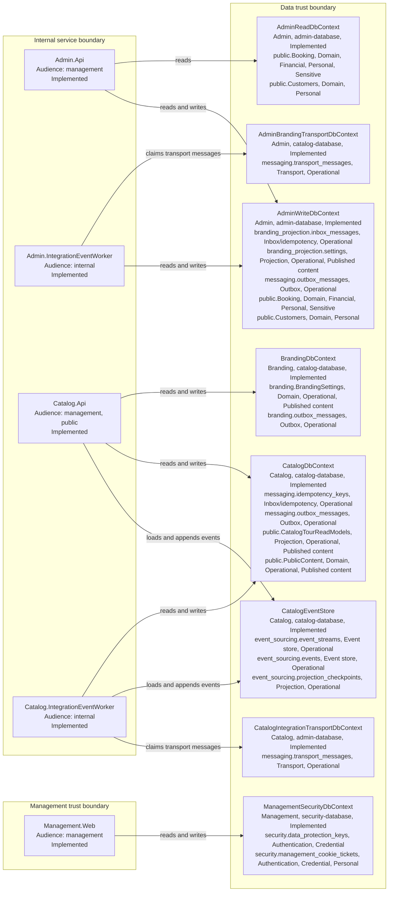

# Data ownership and trust boundaries

[Architecture metadata](architecture-metadata.json) records store ownership, trust boundaries,
audiences, lifecycle, access roles, and representative table data classes. The data view connects
applications to their store access surfaces. A claimant context can use a database provisioned
by a different bounded context.

## Metadata for contributors

- Use `public` for publicly addressable services, `management` for authenticated staff
  entry points, `internal` for application services, `data` for storage, and `external` for
  dependencies operated outside the application boundary.
- Record the user audiences separately from service exposure. For example, Catalog API serves
  public and management audiences through internal service discovery.
- Mark a node `implemented` once present in runtime wiring. Use `planned` for a planned node
  and record the planned state explicitly in the metadata.
- Register each new EF Core context with its database resource, owning bounded context, and
  consuming application. Record access direction, schema/table examples, and their roles. Check
  table identities against EF mappings and table roles against the runtime registration. For
  provider-managed stores, use the provider's registered schema.
- Apply the handling classes in [Privacy classification](../privacy-classification.md).
  Use table names and technical classifications in the view. Keep customer values, credentials,
  payload examples, and connection strings out of the metadata.

## Generated data ownership view

The repository CLI reads the metadata and renders the diagram with PandaBear.Documentation.
Refresh and verify using the repository's pinned .NET SDK.

```bash
dotnet run --project scripts/ViajantesTurismo.Architecture.Tool -- generate .
dotnet run --project scripts/ViajantesTurismo.Architecture.Tool -- verify .
```

Edit the prose outside the generated markers and the metadata in its source file.

<!-- generated:data-ownership:start -->
<!-- Generated by ViajantesTurismo.Architecture.Tool. Do not edit by hand. -->


<!-- generated:data-ownership:end -->
