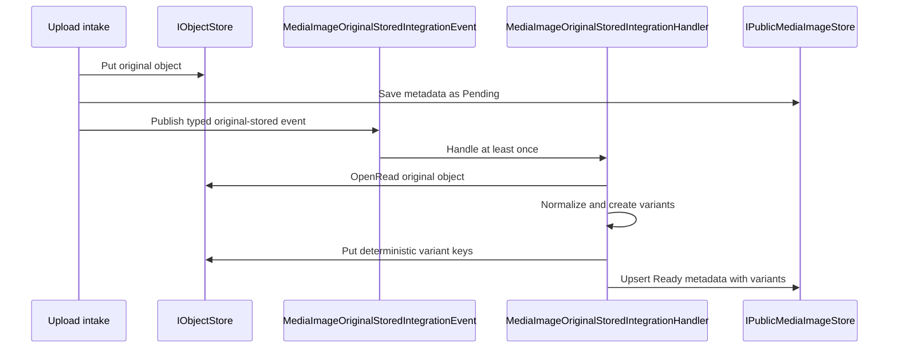
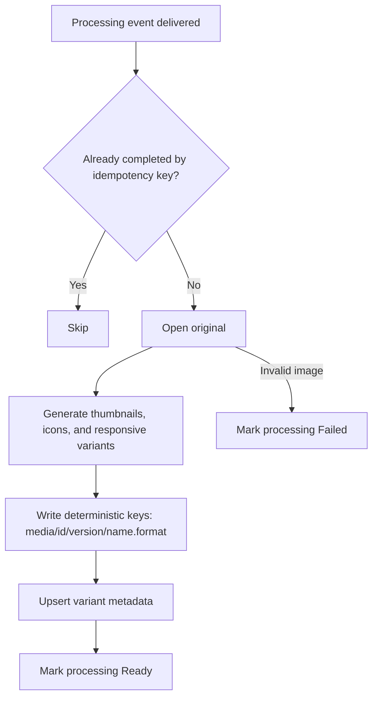

# Media image processing flow

This page documents the Catalog media processing flow.

## Current implemented flow

## Retry and idempotency model

The typed event id is the idempotency key for inbox-style consumers. Variant object keys use the
media id, processing version, variant name, and format so replay overwrites the same objects instead
of appending duplicate variants.

## Shared intake order

The Catalog media upload and the Branding logo upload share the intake order: bounded read through
`SeekableContent`, a small signature peek, malware scan, decode with pixel limits, then hash and store (the logo is first
re-encoded to at most 40 KiB). Decode limits come from `ImageProcessingLimits`: the Catalog values are options
(`MediaUploadValidationOptions`); the Branding values are 2048 x 2048 pixels and 4,000,000 pixels. The Branding flow also
walks container chunks before the scan to refuse animated images, which is a documented deviation; the Catalog flow does not. See
[Upload and binary data guidelines](UPLOAD_AND_BINARY_DATA_GUIDELINES.md#intake-order),
[API I/O and streaming contracts](API_IO_AND_STREAMING.md#branding-logo-flow), and [Branding](branding.md#logo).

The stored content type is derived from the validated type, not copied from the client: the validator matches the declared
type, the extension, and the file signature, and the intake stores the canonical lower-case type. The shared decode probe does
not expose the decoded format, so the signature class stands in for it. Compensation deletes use a separate 10-second token so a
cancelled request still removes its stored original; see
[Catalog media intake flow](API_IO_AND_STREAMING.md#catalog-media-intake-flow).

## Animated images

Catalog gallery uploads may be animated PNG (APNG) or animated WebP, and are accepted by policy; there is no animation check.
The pipeline reduces them to a still image: the decode probe and every variant (WebP, JPEG, AVIF, ICO) are built from the first
frame only, so the stored original stays animated but no served rendition is (ICO is built the same way but is not covered by
the test). `MediaAnimatedImageProcessingTests` shows a
two-frame input producing a one-frame variant for each output format. This is current behaviour of
`MagickImageProcessor` in the pinned SharedKernel package and is not changed here. Animated AVIF sequences (the `avis` brand)
are accepted by the signature check and are likewise not inspected. The Branding logo is different and refuses animation.

CloudEvents remains a transport envelope only; the application contract is the typed integration
event.
