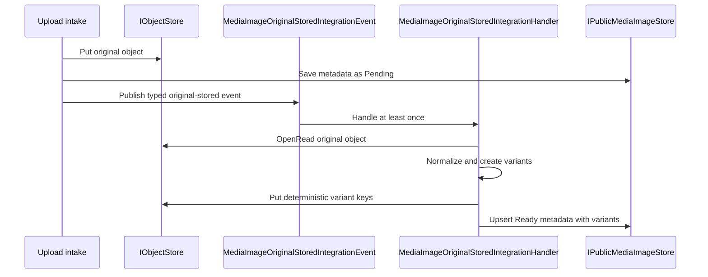
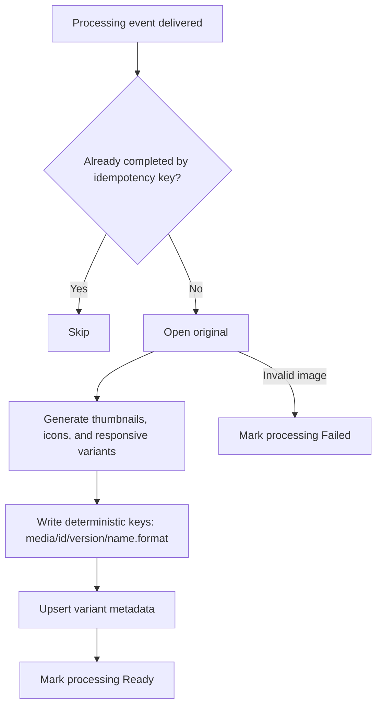

# Media image processing flow

This page documents the Catalog media processing flow.

## Current implemented flow

## Retry and idempotency model

The typed event id is the idempotency key for inbox-style consumers. Variant object keys use the
media id, processing version, variant name, and format so replay overwrites the same objects instead
of appending duplicate variants.

## Shared intake order

The Catalog media upload and the Branding logo upload share the intake order: bounded read through
`SeekableContent`, a small signature peek, malware scan, decode with pixel limits, then hash and store (the logo is first
re-encoded to at most 40 KiB). Decode limits come from `ImageProcessingLimits`: the Catalog values are options
(`MediaUploadValidationOptions`); the Branding values are 2048 x 2048 pixels and 4,000,000 pixels. The Branding flow also
walks container chunks before the scan to refuse animated images, which is a documented deviation; the Catalog flow does not. See
[Upload and binary data guidelines](UPLOAD_AND_BINARY_DATA_GUIDELINES.md#intake-order),
[API I/O and streaming contracts](API_IO_AND_STREAMING.md#branding-logo-flow), and [Branding](branding.md#logo).

The stored content type is derived from the validated type, not copied from the client: the validator matches the declared
type, the extension, and the file signature, and the intake stores the canonical lower-case type. The shared decode probe does
not expose the decoded format, so the signature class stands in for it. Compensation deletes use a separate 10-second token so a
cancelled request still removes its stored original; see
[Catalog media intake flow](API_IO_AND_STREAMING.md#catalog-media-intake-flow).

### Duplicate Catalog uploads

The upload endpoint returns the existing image with its current metadata when a request matches a prior upload. The
response uses the usual `201 Created` status, image ID, and `Location`. It creates no additional gallery entry, original,
or variant-processing event. The endpoint authorizes the target gallery before the lookup.

The private, versioned fingerprint combines the SHA-256 digest of the original bytes, the original byte count, the canonical
media type, the exact set of gallery IDs, and the normalized alt text, caption, attribution, copyright, and tags.
Gallery order and cover status come from the server. Different original bytes or gallery and
editorial inputs create separate images. An edit to the original's gallery ownership or editorial attributes invalidates its
prior fingerprint. Uploads recorded before the fingerprint was introduced have no original-byte identity.

Each upload that passes the size, type, and signature checks reaches the configured malware scanner. Its verdict allows a
lookup before sanitizing, decoding, or writing a new original. The existing image must meet the current decoded-size limits.
PostgreSQL serializes requests with the
same advisory lock key and compares the full SHA-256 fingerprint. Two different fingerprints with the same numerical lock
key wait on each other and remain separate uploads. Equal full fingerprints represent the same upload identity. Bump the
fingerprint version when a change in intake policy requires existing bytes to run through sanitization or decoding again.
The fingerprint and storage keys are private and omitted from upload response fields and duplicate lookup telemetry.

## Animated images

Catalog gallery uploads may be animated WebP or animated PNG (APNG), and are accepted by policy; there is no animation check.
The pipeline reduces them to a still image: the decode probe and every variant (WebP, JPEG, AVIF, ICO) are built from the first
frame only, so the stored original stays animated but no served rendition is (ICO is built the same way but is not covered by
the test). `MediaAnimatedImageProcessingTests` shows a
two-frame animated WebP producing a one-frame variant for each output format (WebP, JPEG, AVIF). No test covers APNG input:
Magick.NET cannot write APNG on every platform (the CI runner produced an empty file), and ImageMagick is documented to read
only the default image of an APNG, which is unverified here. This is current behaviour of
`MagickImageProcessor` in the pinned SharedKernel package and is not changed here. Animated AVIF sequences (the `avis` brand)
are accepted by the signature check and are likewise not inspected. The Branding logo is different and refuses animation.

CloudEvents remains a transport envelope only; the application contract is the typed integration
event.
