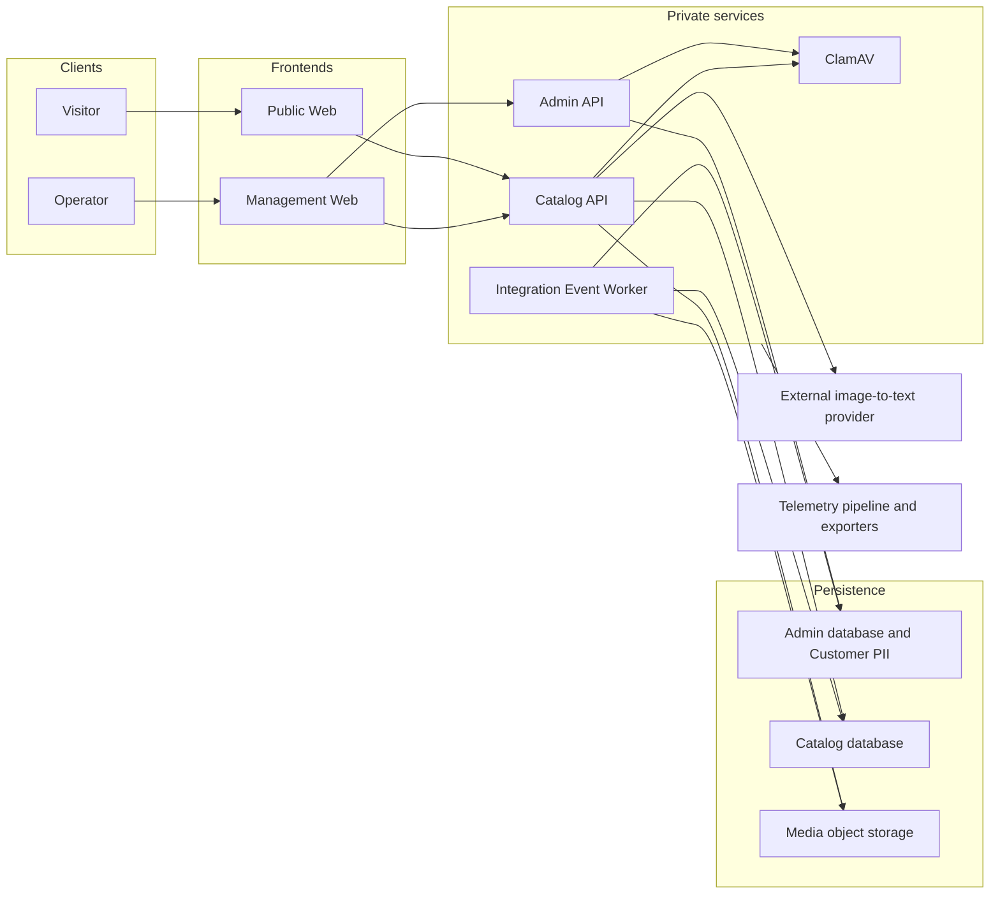

# STRIDE-A threat model

## Scope

This model covers the current Aspire-hosted application: Public Web, Management Web, Admin API,
Catalog API, Integration Event Worker, PostgreSQL databases, Redis cache, media/object storage,
ClamAV, OpenTelemetry exporters, and external clients. The configured image-to-text provider is a
separate data-processing boundary. This models repository-supported flows, not a deployed production
topology; service discovery alone does not establish visitor identity or transport protection.

## Actors and assets

- Anonymous visitor: reads published tour, gallery, theme, and marketing content through Public Web.
- Operator/editor: uses Management Web for tours, customers, bookings, public content, theme, media,
  and customer import workflows.
- Internal services: Admin API, Catalog API, Integration Event Worker, migration service, databases,
  cache, malware scanner, object storage, and telemetry pipeline.
- External image-to-text provider: receives the selected image and supplied generation context.
- Assets: Customer PII, booking/payment state, medical and identification details, media files,
  public content, integration events, logs, traces, configuration, and provider credentials.

## Trust boundaries and data flows

1. Browser to Public Web: anonymous requests for published pages and media through trusted ingress.
2. Browser to Management Web: operator requests crossing the browser-session boundary.
3. Public Web to Catalog API: new server-side requests for tours, content, and media. Visitor
   attribution must survive this separate connection through explicitly trusted peers; one visitor
   must not consume another visitor's public quota.
4. Management Web to Admin API and Catalog API: service-discovery HTTP calls crossing API
   authorization boundaries. Internal network placement does not replace endpoint permissions.
5. Admin API to Admin database: customer, booking, payment, import, and integration-event writes.
   Identity, contact, medical, identification, and financial fields follow the
   [privacy classification](../privacy-classification.md).
6. Customer upload to Admin API and ClamAV: enforce request/file budgets, scan the bounded received
   bytes, then decode and import. Rejected files and failed or unavailable scans do not reach import.
7. Media upload to Catalog API and ClamAV: scan bounded bytes before decoding and storage. Failed,
   rejected, or pending scan results do not create an accepted upload. Explicit disabled-scanner
   development modes are distinct from successful malware scanning.
8. Catalog API and Integration Event Worker to Catalog database and object storage: media metadata,
   original images, variants, public content, and projection processing.
9. Catalog API to the image-to-text provider: send the selected image, language, supplied context,
   and optional coordinates. Returned accessibility text remains a human-review-required draft.
10. Admin integration events to Catalog consumers: outbox/inbox transport across service and
    persistence boundaries.
11. Services to telemetry exporters: operational logs, metrics, and traces without Customer PII or
    sensitive payloads. Collector ingress, exporter access, and transport need deployment controls.

The logical boundaries below do not prescribe a hosting platform:

## STRIDE-A findings

The six STRIDE categories distinguish existing controls from remaining risks:

| Category | Threat | Existing control and remaining work |
| --- | --- | --- |
| Spoofing | Forged caller or visitor attribution across browser/service hops | API authorization and configured trusted forwarding exist. Public Web overwrites downstream forwarding with the current resolved connection address; Catalog accepts forwarded attribution only from configured trusted peers. Arbitrary caller headers cannot establish visitor identity. |
| Tampering | Modified import rows, uploaded binaries, or public-content changes | Request/file budgets, malware scanning, image validation, and application/domain checks protect intake. These controls do not establish every business invariant or imported field's validity. |
| Repudiation | Denial of sensitive operator actions or business-record changes | Operational telemetry supports diagnostics. Durable business audit remains separate; logs are not an audit trail. |
| Information disclosure | Customer PII or credentials exposed in responses, logs, traces, storage, or provider requests | EF sensitive logging is development-gated; classification, omission, and redaction cover scopes, formatted messages, and telemetry. Provider data handling requires an explicit deployment decision. |
| Denial of service | Shared quotas, expensive image processing, scanner/provider failure, or repeated mutations | Named risk-based limits, bounded input processing, and fail-closed scanning exist. Public Web admission and Catalog quotas use resolved visitor partitions; Catalog quota responses do not trigger shared retries or circuit-breaker failures. Proxy allowlists, capacity budgets, and replica behavior require deployment-specific validation. |
| Elevation of privilege | Anonymous or lower-permission callers reaching management, publication, import, or AI operations | Separate endpoint permissions exist. Authentication/authorization implementation belongs to its own epic; this model does not claim all authorization risks are closed. |

## Upload and import

Malware scanning is implemented for media and customer import. Scanner failure and explicit development
bypass states remain separate from successful scan results. Validation rejects unsupported, empty,
oversized, or malformed input with generic errors; scanning does not establish semantic validity or
remove personal data.

Branding logo upload (`PUT /api/v1/branding/settings/logo`, raw request body, authorized and rate limited). Threats and the
mitigations that exist in code:

- Spoofed type: the declared type is allow-listed (PNG, JPEG, WebP; SVG refused) and checked against the file signature.
- Oversize or slow body: a 1 MiB request limit and a 1 MiB `SeekableContent` byte limit, with a 256 KiB memory spool threshold.
- Malicious or polyglot image: malware scan (a hit is rejected, an unavailable scanner is `503`), decode limits of 2048 x 2048
  pixels and 4,000,000 pixels, and a re-encode to WebP of at most 40 KiB that strips metadata.
- Animated image: refused by a bounded chunk walk.
- Hostile content address on read: the hash is validated with an anchored pattern before the store is read.
- Browser sniffing of served bytes: `nosniff`, a fixed `image/webp` type, and a content-addressed immutable response.

Residual risks: the animation chunk walk is hand-written parsing that runs before the scan and has a proven fault on a
hostile length field; there is no Branding wire test over real Kestrel; stored logos are never garbage collected; the logo
bytes ship in every revision's outbox payload. These are tracked in the I/O hardening epic. See
[Upload and binary data guidelines](../UPLOAD_AND_BINARY_DATA_GUIDELINES.md) and [Branding](../branding.md#logo).

## AI-assisted accessibility abuse

The current AI flow drafts text from an image; it does not generate image binaries.

- Treat image content, supplied context, and provider output as untrusted. The media-AI permission
  and mutation policy gate drafting; a separate write-authorized review approves accessibility text.
  Public image variants require reviewed text.
- Images, context, language, and optional coordinates cross a provider disclosure boundary. Retention,
  training, residency, and provider access policies have not been established by this model.
- Repeated generation can consume provider capacity or cost. Bounded adapter input and request limits
  reduce exposure; deployment/provider quotas require their own evidence.
- Provider failures must not promote unreviewed output or expose credentials, image payloads, supplied
  context, or raw exceptions through telemetry. Human review is not a claim of prompt-injection immunity.

## Notes

Baseline controls and validation are tracked by the canonical roadmap records for
[web headers and CSP](../../roadmap/items/RM-104-github-815.json),
[rate limiting](../../roadmap/items/RM-105-github-816.json),
[CORS](../../roadmap/items/RM-106-github-817.json),
[PII logging](../../roadmap/items/RM-107-github-818.json), and
[customer import](../../roadmap/items/RM-108-github-819.json).
These maintained records identify the control backlog and its external integration. Automated
documentation checks do not establish that
the runtime controls are effective. Current security tests and the separate deep-scan reports provide
their own evidence.

[Uploaded-file antivirus scanning](../../roadmap/items/RM-154-github-932.json) records the completed
scanner integration. [Durable audit functionality](../../roadmap/items/RM-036-github-575.json) remains
separate from the baseline. Direct-API rate-limit tests alone do not prove visitor isolation through
Public Web; that boundary needs malicious and legitimate controls across frontend replicas.

Authorization provider and policy implementation are intentionally outside this epic and remain governed by
the authentication/authorization epic. This baseline does not weaken existing validation, privacy, or data
safety rules.
